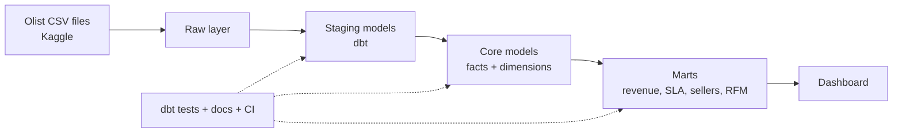

# Olist Marketplace Intelligence Warehouse

A dbt-powered warehouse on the public Olist e-commerce dataset, built to improve marketplace revenue, delivery reliability, and seller quality.

See the full [project brief](docs/project_brief.md).

## Architecture



## Setup (Windows)

Requirements: Python 3.12, Git, DuckDB CLI, Docker Desktop, VS Code.

```
git clone https://github.com/viniska13/olist-marketplace-intelligence-warehouse.git
cd olist-marketplace-intelligence-warehouse
py -3.12 -m venv .venv
.venv\Scripts\activate
pip install -r requirements.txt
dbt --version
```

## Dashboard screenshots

_Coming soon._