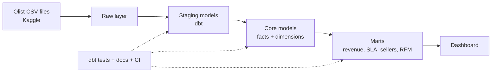

# Olist Marketplace Intelligence Warehouse

## 1. Overview
Olist is a Brazilian e-commerce marketplace that connects small sellers to customers. This project builds a dbt-powered warehouse on Olist's public dataset to turn raw order data into trusted tables for revenue, delivery, and seller analysis.

## 2. Business Objective
Improve marketplace revenue, delivery reliability, and seller quality.

## 3. Target Users
| Team | How they use the warehouse |
|------|---------------------------|
| Marketplace Operations | Monitor late deliveries and fulfillment problems |
| Finance | Track revenue, freight cost, payment trends |
| Seller Management | Identify weak or risky sellers |
| Analytics | Query clean, tested tables for deeper analysis |

## 4. Business Domains
1. Revenue and growth
2. Fulfillment and delivery SLA
3. Seller performance and risk
4. Customer retention and RFM
5. Data quality and warehouse health

## 5. Business Questions
### Revenue and growth
1. Which product categories generate the most revenue?
2. How does monthly revenue trend over time?
3. What is the average order value by state?
4. Which payment methods are used most?

### Fulfillment and delivery SLA
5. Which states have the highest late-delivery rate?
6. What is the average gap between estimated and actual delivery date?
7. How does freight cost affect customer review score?

### Seller performance and risk
8. Which sellers have the worst on-time delivery rate?
9. Which sellers have deteriorating performance over time?
10. How concentrated is revenue among the top sellers?
11. Which sellers have low review scores and high order volume?

### Customer retention and RFM
12. What percentage of customers place a second order?
13. Who are the highest-value customers (RFM segments)?
14. How long does it take customers to place a second order?

### Data quality and warehouse health
15. How many orders have missing delivery dates?
16. Are there orders without matching payments or items?
17. How fresh is the latest data load?

## 6. Success Criteria
- [ ] All core facts and dimensions built
- [ ] At least 40 dbt tests passing
- [ ] SCD Type 2 implemented
- [ ] Dashboard answers the business questions
- [ ] CI and docs deployed

## 7. Architecture
